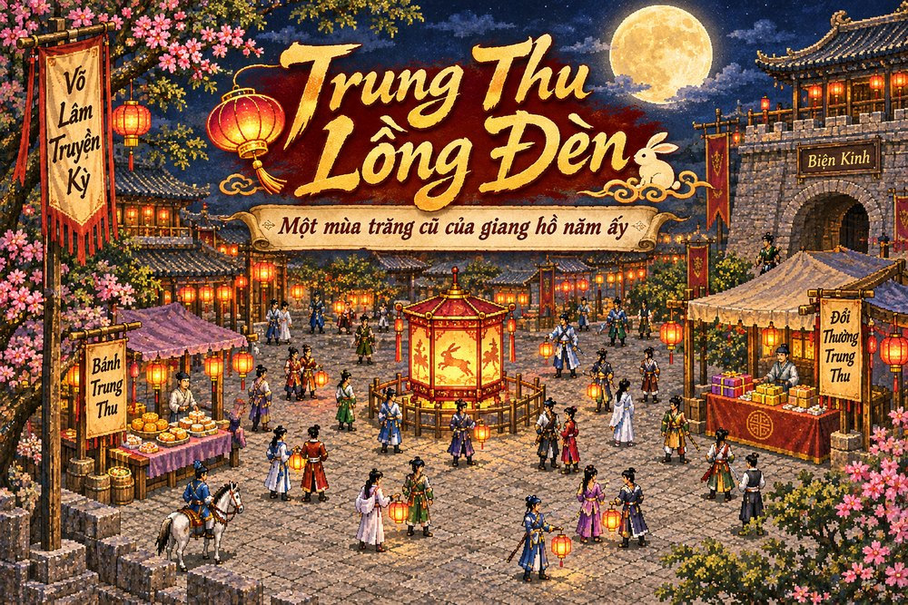
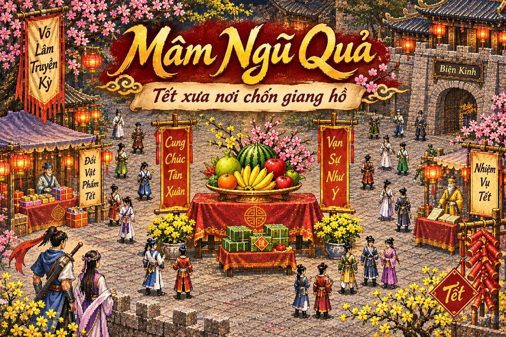
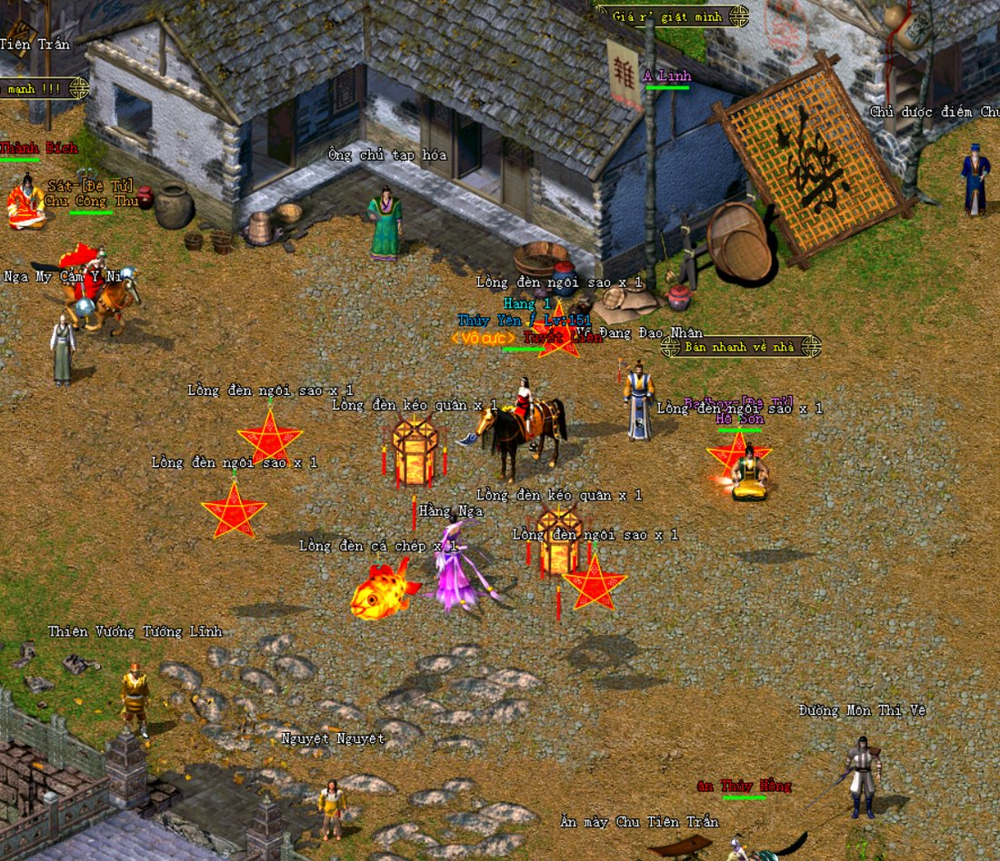
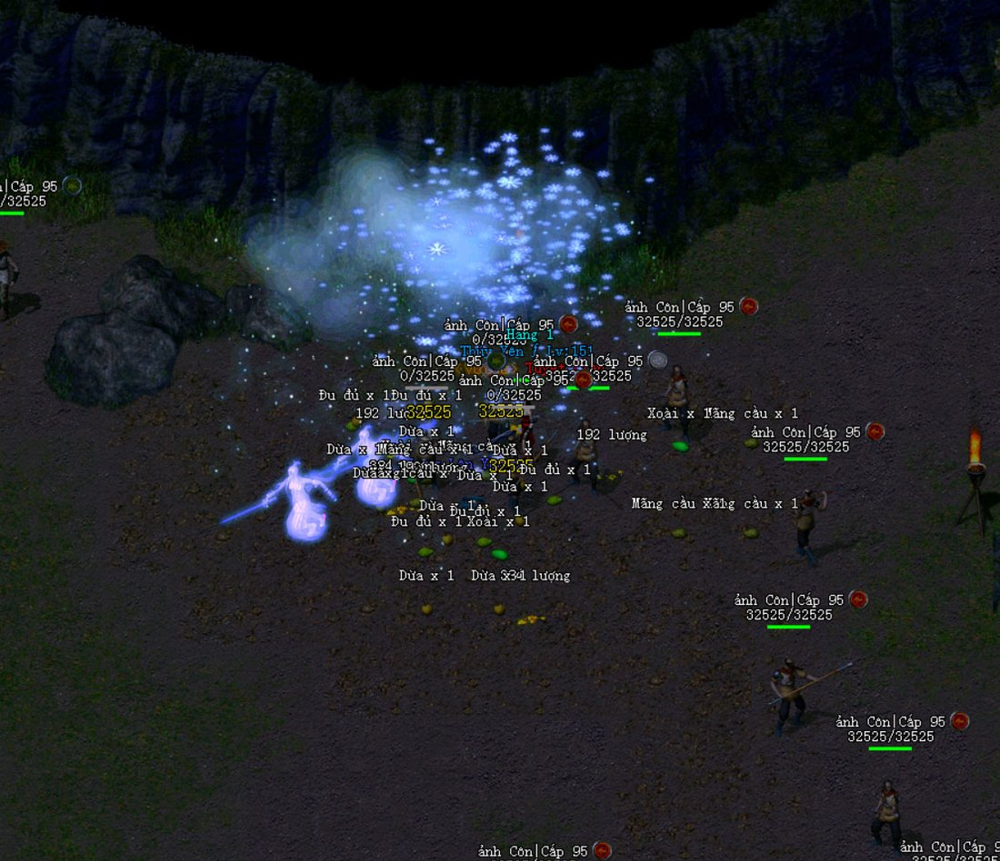

# JxOffline V5 Classic Events Remastered

**JxOffline V5 (by ACE) · Beta cộng đồng đầu tiên** (phiên bản phát hành: v1.1.0-beta.1)

Addon: `cgpt`

**Nền tảng JxOffline V5:** ACE và Mel.

**Bộ cài WSL2:** Võ Duy Khánh (VDK).

**Cảm ơn:** PGaming và các anh em dev đi trước đã để lại mã nguồn và tư liệu quý giá.

**Nhóm phục dựng addon:** **CGPT — Classic Game Preservation Team** (Cường + Chat GPT).

## Bắt đầu tại đây

**Addon là phần bổ sung sự kiện, không phải bộ game đầy đủ.** Anh em cần có JxOffline V5, V5.1 hoặc V5.2 chạy được trước khi cài.

- **[Tải addon CGPT Beta — bản chép trực tiếp (Full.zip)](https://github.com/cuonghappypets/jxoffline-v5-classic-events-remastered/releases/download/v1.1.0-beta.1/CGPT_1.1.0-beta.1_Full.zip)**: dành cho đa số anh em, chỉ cần giải nén và chép file.
- **[Hướng dẫn chi tiết cách cài đặt, cấu hình kết nối và cập nhật addon](INSTALL.md)**.
- **[Hướng dẫn chép file từ Windows sang server bằng WinSCP](INSTALL.md#chép-file-từ-windows-sang-server-bằng-winscp-sftp)**.
- [Mở cẩm nang 61 sự kiện](https://cuonghappypets.github.io/jxoffline-v5-classic-events-remastered/) · [Gửi góp ý](https://github.com/cuonghappypets/jxoffline-v5-classic-events-remastered/issues).

Chưa có game? Xem mục [Cài JxV5 bằng bộ cài WSL2 của VDK](#cài-jxv5-bằng-bộ-cài-wsl2-của-vdk). Đã chơi được game gốc? Chuyển thẳng đến mục [Cài đặt và đồng bộ addon](#cài-đặt-và-đồng-bộ-addon).

**Đừng tải mục Source code (zip) trên GitHub để cài addon.** Dùng đúng file CGPT có liên kết tải ở trên.

## Một chút hồi ức Võ Lâm

Chào anh em!

Không biết còn bao nhiêu anh em nhớ những ngày chạy khắp bản đồ săn trái cây làm Mâm Ngũ Quả, những mùa Trung Thu gom nguyên liệu làm lồng đèn, hay những lần thức khuya chỉ để kiếm thêm vài vật phẩm đổi thưởng. Thời ấy, niềm vui chơi Võ Lâm đôi khi cũng chỉ đơn giản như vậy.

Nhờ có bản JxOffline V5 của hai bác ACE và Mel, mình cùng ông dev CGPT đã tranh thủ vài ngày đào bới, chắp vá và chế cháo để phục dựng lại những sự kiện Võ Lâm Truyền Kỳ giai đoạn 2005–2010. Đến nay, addon đã tập hợp được **61 sự kiện**, từ Tết Nguyên Đán, Trung Thu, Giáng Sinh, Valentine, các ngày lễ trong năm, sinh nhật Võ Lâm cho đến những hoạt động đặc biệt khác.

## Có gì trong addon?

Các sự kiện được chia thành những nhóm lễ hội để anh em dễ tìm và chủ động trải nghiệm. Addon bổ sung **Hồi Ức Võ Lâm Lệnh**, với hai nhóm **Quản lý lễ hội** và **Quản lý tính năng** (các hoạt động nguyên bản). Mục đầu của Quản lý lễ hội cho phép quản lý sự kiện hiện tại: tạm dừng nhưng vẫn cho đổi thưởng, hoặc đóng và ngừng đổi thưởng. Thích đón Tết giữa tháng Bảy hay chơi Trung Thu vào đêm giao thừa cũng được. :)))

Kèm theo addon là cẩm nang HTML với 61 bài viết, tổng hợp thể lệ, cách tham gia, vật phẩm, công thức, phần thưởng và tư liệu lịch sử còn tìm được.

Dự án chỉ tập trung vào phục dựng lễ hội, tôn trọng game gốc và ý đồ của các tác giả JxOffline V5. Đây là addon cộng đồng phi thương mại, không phải sản phẩm chính thức của nhà phát hành. Kho mã không đính kèm bộ game đầy đủ, tài khoản, cơ sở dữ liệu hoặc dữ liệu lưu nhân vật, cũng như mã và tài nguyên chưa rõ quyền phân phối.

## Hình ảnh những mùa lễ hội

| Trung Thu Lồng Đèn | Mâm Ngũ Quả |
| :---: | :---: |
|  |  |

*Hai banner minh họa gợi nhớ không khí lễ hội năm xưa, không phải ảnh chụp trong game.*

| Lồng đèn tại Chu Tiên trấn | Săn nguyên liệu tại Khóa Lang động |
| :---: | :---: |
|  |  |

*Ảnh chụp trong quá trình chơi thử, cắt khung để tập trung vào cảnh sự kiện.*

## Vài lời về bản beta

Phần quan trọng nhất mình muốn chia sẻ là addon này mới được thực hiện trong vài ngày, với chút ký ức còn sót lại sau gần hai thập kỷ và lượng mã nguồn, dữ liệu ít ỏi mà PGaming cùng các anh em dev đi trước đã để lại.

Có sự kiện còn tương đối đầy đủ dữ liệu, nhưng cũng có sự kiện chỉ còn vài đoạn script, vài vật phẩm hoặc một bài viết cũ. Những cơ chế bị thất lạc phải được suy luận, tái tạo và chế cháo thêm để có thể hoạt động. Cái gì tìm được căn cứ thì cố gắng giữ đúng; phần chưa đủ tư liệu vẫn có thể khác với nguyên bản.

Những sự kiện quen thuộc như **Trung Thu Lồng Đèn** và **Mâm Ngũ Quả** hiện đã tương đối ổn. Tuy nhiên, điều đó không có nghĩa là cả 61 sự kiện đã được kiểm thử gameplay đầy đủ hay phục dựng chính xác như ngày xưa. Bản beta được giữ để anh em chơi thử và góp ý. Nhóm sẽ tập trung tiếp nhận phản hồi trước khi mở lại đợt phát triển. Về nền tảng, nhóm phát triển xác nhận addon tương thích với JxOffline V5, V5.1 và V5.2 của ACE và Mel. Bản beta đầu tiên cho phép mở 60 sự kiện; Thép Tinh Luyện tạm khóa để kiểm tra rủi ro nhận thưởng.

## Cộng đồng Vozer Truyền Kỳ Vui Vẻ

Anh em có thể tham gia [Discord Vozer Truyền Kỳ Vui Vẻ](https://discord.gg/B7WEFRDwT) để tải bản JxV5 gốc, trao đổi kinh nghiệm cài đặt và thảo luận cùng Mel, ACE và cộng đồng người chơi.

## Cài JxV5 bằng bộ cài WSL2 của VDK

**Chỉ làm phần này nếu anh em chưa có JxV5 chạy được.** Nếu đã vào game bình thường, không cần cài lại game gốc hay nâng cấp lên V5.2.

1. Tải [bộ cài WSL2 của bác Võ Duy Khánh](https://drive.google.com/file/d/1DAgjb3Ari2zednom28EDCt2Biu0xkLqK/view?usp=drive_link). Tải thêm bộ Server (`.tgz`) và Client JxV5 (bộ file để mở game trên Windows) từ cộng đồng Vozer Truyền Kỳ Vui Vẻ ở trên.
2. Chạy `VLTK-Server.exe` để khởi tạo lần đầu. Sang tab **Quản lý file**, tải file Server `.tgz` lên đúng vị trí theo hướng dẫn bộ cài rồi giải nén tại chỗ.
3. Trở lại tab **Bảng điều khiển**, chọn `jxser` ở cạnh nút **Khởi động**, rồi bấm **Khởi động** để chạy Server. Nếu dùng thư mục server khác, chọn đúng thư mục đó.
4. Khi Server đã khởi động, chạy `Game.exe` trong thư mục Client để vào game.

Kiểm tra game gốc hoạt động bình thường trước khi cài addon CGPT. Nếu chưa vào được game, hãy hỏi cộng đồng về bộ cài trước; addon không thay thế hoặc sửa lỗi cài đặt của game gốc. Bộ cài WSL2 và game gốc là các sản phẩm riêng, không nằm trong gói addon CGPT.

## Cài đặt và đồng bộ addon

**[Tải CGPT Community Beta 1.1.0 — bản chép trực tiếp](https://github.com/cuonghappypets/jxoffline-v5-classic-events-remastered/releases/download/v1.1.0-beta.1/CGPT_1.1.0-beta.1_Full.zip)** — tải file `CGPT_1.1.0-beta.1_Full.zip`, không phải Source code (zip).

Chỉ cần tải một gói. Người mới nên chọn bản chép trực tiếp. Gói này đã có sẵn thư mục `cgpt` chứa các file cần thiết cho addon. Không cần chạy script chuẩn bị. [Bản vá tạo file từ bộ gốc](https://github.com/cuonghappypets/jxoffline-v5-classic-events-remastered/releases/download/v1.1.0-beta.1/CGPT_1.1.0-beta.1.zip) vẫn được giữ lại cho anh em muốn đối chiếu dữ liệu đầu vào.

> **[Hướng dẫn chi tiết cách cài đặt, cấu hình kết nối và cập nhật addon](INSTALL.md)** — có hướng dẫn sao lưu, chép đúng thư mục, đồng bộ Client và khôi phục khi gặp lỗi.
>
> Nếu cần chuyển file từ Windows sang Linux, xem **[Cách chép file bằng WinSCP (SFTP)](INSTALL.md#chép-file-từ-windows-sang-server-bằng-winscp-sftp)** (địa chỉ, cổng kết nối, tài khoản và cách chép file từng bước).

### Bước 1 — Sao lưu và giải nén

1. Có bộ **JxOffline V5, V5.1 hoặc V5.2 của ACE và Mel**, chơi được bình thường. Không bắt buộc nâng cấp lên V5.2. Các bản mod khác cần đối chiếu xung đột trước khi cài.
2. Thoát game, dừng GameServer và sao lưu server, Client và dữ liệu nhân vật. Nếu sao chép cả file đĩa máy ảo, tắt hẳn môi trường Linux trước khi sao chép. Nên thử trên bản sao trước.
3. Tải bản `CGPT_1.1.0-beta.1_Full.zip` từ Releases và giải nén vào thư mục riêng. Thư mục `cgpt` đã có sẵn. Nếu chọn bản vá thay thế, làm theo hướng dẫn trong README của bản vá để tạo thư mục `cgpt` trước khi đồng bộ.

### Bước 2 — Chép file vào server và Client

Thư mục `cgpt` có cấu trúc `cgpt/server1/` và `cgpt/Client/` (chỉ các file cần thiết cho lễ hội). Đọc ghi chú tương thích của chính gói đó trước khi chép.

| Thư mục nguồn trong gói | Thư mục đích trong game |
| --- | --- |
| `cgpt/server1/script/` | `server1/script/` trên server Linux |
| `cgpt/server1/settings/` | `server1/settings/` trên server Linux |
| `cgpt/Client/settings/` | `settings/` trong thư mục Client Windows |

**Server** là phần game chạy trên Linux. **Client** là thư mục game trên Windows có file `Game.exe`.

1. Bật môi trường Linux (WSL2 hoặc máy ảo) để chép file, nhưng chưa khởi động GameServer. Dùng tab **Quản lý file** của VDK hoặc WinSCP. Xác định đúng thư mục server đang sử dụng: ví dụ `/home/jxser/server1` hoặc `/home/jxser_new/server1`.
2. Chép **gộp nội dung** hai thư mục `script` và `settings` vào server theo bảng trên. Không xóa file khác hoặc thay cả thư mục game. Ví dụ, chép nội dung `cgpt/server1/script/` vào `/home/jxser/server1/script/` nếu đang dùng thư mục server đó. Không tạo thêm cấp `server1/server1`, `script/script` hoặc `settings/settings`. Giữ nguyên file và mã chữ TCVN3.
3. Chép riêng nội dung `cgpt/Client/settings/` vào `settings/` của Client trên Windows. Không chép Client lên Linux. Không tạo thêm cấp `Client/Client`. Những thay đổi bảng vật phẩm cần đồng bộ cả hai phía.

#### Chép file từ Windows sang server bằng WinSCP

[WinSCP](https://winscp.net/) là chương trình giúp anh em kéo thả file từ Windows sang Linux mà không cần gõ lệnh.

**[Xem hướng dẫn WinSCP từng bước — thông số kết nối và cách chép file](INSTALL.md#chép-file-từ-windows-sang-server-bằng-winscp-sftp).**

Mở WinSCP, kết nối theo bảng thông số trong hướng dẫn trên. Khung trái là file Windows, khung phải là file Linux. Mở thư mục `cgpt/server1` ở bên trái và đúng thư mục `server1` ở bên phải. Chọn hai thư mục `script` và `settings`, chép sang phải ở chế độ **Binary** để giữ nguyên file. Chỉ ghi đè các file cần cập nhật sau khi đã sao lưu, không dùng chế độ đồng bộ có xóa file đích. Chờ chép xong và đóng WinSCP.

Vẫn phải chép riêng phần Client trên Windows theo dòng Client trong bảng bên trên. Nếu WinSCP không kết nối được, xem hướng dẫn chi tiết, không mở cổng ra Internet chỉ để chép file cục bộ.

### Bước 3 — Khởi động lại và vào sự kiện

Khởi động lại GameServer, mở game. Vào **Cẩm Nang Đồng Hành → Nhận Lệnh bài Hồi Ức → Hồi Ức Võ Lâm Lệnh**. Dùng lệnh bài để vào **Quản lý lễ hội**, chọn mùa và sự kiện muốn chơi. Mục **Quản lý tính năng** dành cho các hoạt động nguyên bản.

Chỉ mở một sự kiện tại một thời điểm. [Xem hướng dẫn chung trong cẩm nang](https://cuonghappypets.github.io/jxoffline-v5-classic-events-remastered/guide.html) nếu chưa biết bắt đầu từ đâu.

### Cập nhật bản mới hoặc gỡ addon

- Với bản cập nhật nhỏ, sao lưu các file sẽ thay, dừng GameServer, chép đúng các file cập nhật server/client được cung cấp cho phiên bản đang dùng rồi khởi động lại. Không lấy gói cập nhật của bản khác ghép vào.
- Nếu lỗi, dừng game và GameServer và dùng gói khôi phục đúng phiên bản hoặc bản sao lưu. Khôi phục file không hoàn tác vật phẩm, EXP hoặc tiến độ đã phát sinh; nếu cần khôi phục cả dữ liệu, dùng bản sao lưu đầy đủ.
- Nếu bộ game đã được tùy chỉnh, không chép đè bảng vật phẩm hoặc script dùng chung khi chưa đối chiếu xung đột. Addon chỉ thay đổi những phần cần thiết để tích hợp sự kiện.

**[Đọc hướng dẫn cập nhật và khôi phục chi tiết](INSTALL.md#5-cập-nhật-addon).**

### Trạng thái bộ cài

Bản beta cộng đồng đầu tiên đã có file tải. Hai gói cài cho cùng nội dung addon và đã được kiểm tra tính toàn vẹn. Nhóm phát triển xác nhận tương thích V5, V5.1 và V5.2 của ACE và Mel; việc cài đặt trên bộ game sạch và chơi thử đầy đủ từng sự kiện của chính gói phát hành này vẫn chưa được kiểm chứng độc lập. Thép Tinh Luyện đang tạm khóa để tránh rủi ro nhận thưởng.

## Cẩm nang và góp ý

*Bấm vào ảnh để mở cẩm nang và tìm sự kiện muốn chơi.*

Anh em nào có thời gian thì tải gói beta về chơi thử nhé! Không cần test hết 61 sự kiện đâu, cứ chọn những sự kiện mình từng chơi và còn nhớ là quý lắm rồi.

Nếu thấy cơ chế chưa đúng, tỷ lệ rơi đồ hoặc phần thưởng chưa hợp lý, gặp bug hay đơn giản là nhớ một chi tiết khác với bản phục dựng, anh em cứ thoải mái góp ý. Không cần biết lập trình hay đọc source; đôi khi chỉ một câu *“Hồi đó tôi nhớ sự kiện này không phải chơi như vậy…”* cũng đã là một manh mối rất quý.

  

- [Cẩm nang Hồi Ức Võ Lâm – 61 sự kiện](https://cuonghappypets.github.io/jxoffline-v5-classic-events-remastered/)
- [Hướng dẫn chi tiết cách cài đặt, cấu hình kết nối và cập nhật addon](INSTALL.md) (bao gồm cách gỡ addon)
- [Cách chép file bằng WinSCP (SFTP)](INSTALL.md#chép-file-từ-windows-sang-server-bằng-winscp-sftp)
- [Những thay đổi qua các phiên bản](CHANGELOG.md)
- [Danh sách sự kiện để anh em chơi thử](COMMUNITY_UAT.md)
- [Mẫu báo lỗi](REPORT_BUG.md)
- [Gửi góp ý qua GitHub Issues](https://github.com/cuonghappypets/jxoffline-v5-classic-events-remastered/issues)
- [Releases – tải gói addon](https://github.com/cuonghappypets/jxoffline-v5-classic-events-remastered/releases)

Cẩm nang giữ nội dung chi tiết và liên kết nguồn; các icon vật phẩm chỉ là minh họa, không phải hình gốc trong game.

## Lời cảm ơn

Đặc biệt cảm ơn hai bác **ACE và Mel** đã làm nên nền tảng JxOffline V5 để anh em có cơ hội trở lại Võ Lâm. Cảm ơn bác **Võ Duy Khánh (VDK)** đã chia sẻ bộ cài WSL2, giúp anh em thuận tiện hơn khi cài đặt và trải nghiệm game. Cảm ơn **PGaming** và các anh em dev đi trước đã để lại những đoạn source và tư liệu quý giá cho cộng đồng. Nếu không có công sức của mọi người, chắc cũng chẳng có addon này. :D

Gần hai mươi năm đã qua, mã nguồn có thể thất lạc, tư liệu có thể không còn, nhưng đâu đó trong ký ức mỗi anh em vẫn còn một mảnh Võ Lâm ngày ấy.

Hy vọng chúng ta có thể cùng nhau nhặt nhạnh những mảnh ký ức đó, ghép lại thành một Hồi Ức Võ Lâm trọn vẹn hơn.

Chúc anh em chơi game vui vẻ!
